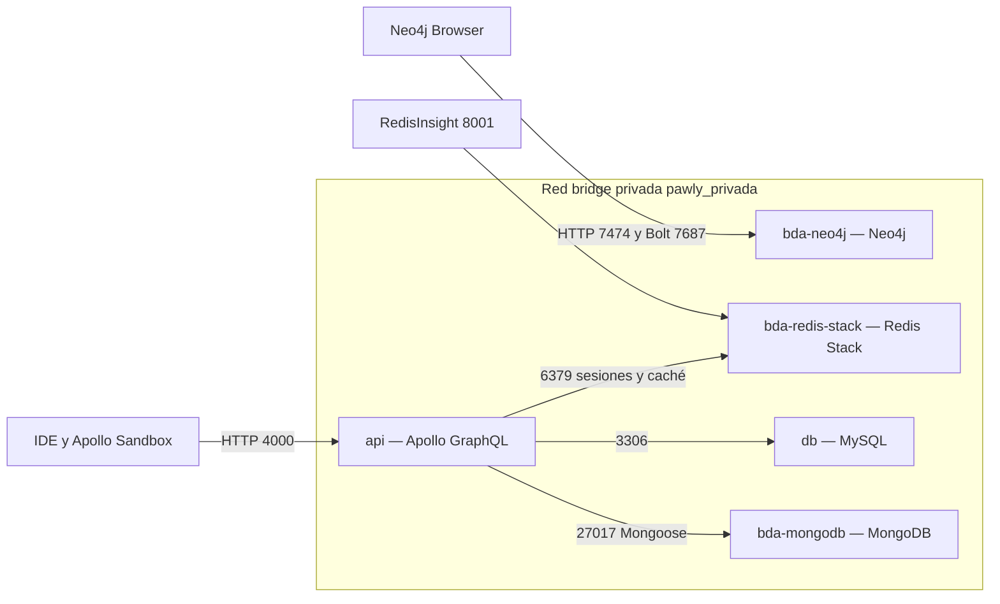
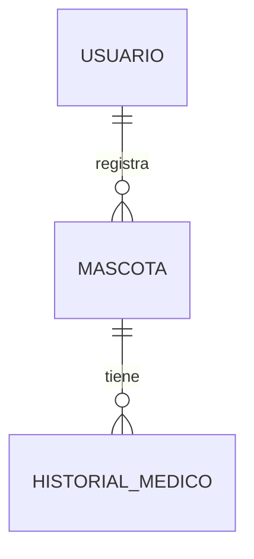
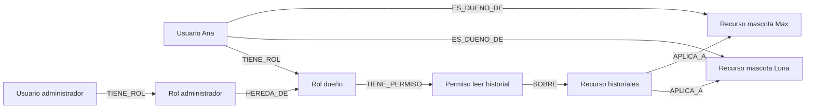

# Pawly Segundo Parcial de Bases de Datos Avanzadas

Pawly permite que **un usuario registre varias mascotas** y administre el cuidado
individual de cada una. Este entregable incorpora MongoDB para el historial
médico, Redis Stack para caché y sesiones, y un modelo RBAC demostrable en Neo4j.
La API existente continúa en Node.js y Apollo Server con GraphQL. MySQL conserva
usuarios, mascotas y los otros módulos del proyecto.

El alcance sigue el documento **Examen Segundo Bases de datos avanzadas** del
Parcial 2. La demostración se concentra en las mascotas Luna y Max de una misma
cuenta. Los datos de demostración son ficticios.
El recorrido práctico y los resultados esperados están en [DEMOSTRACION.md](DEMOSTRACION.md).

## 1 Correspondencia con la rúbrica

| Criterio | Evidencia entregada | Puntos del examen |
| --- | --- | ---: |
| Arquitectura Docker | Diagrama, red, puertos, volúmenes y Compose | 3 |
| Modelo RBAC en Neo4j | Nodos, relaciones, restricciones y consultas Cypher | 3 |
| Justificación NoSQL | Sección 3 de este documento | 3 |
| API Gateway GraphQL | SDL, queries, mutations y resolvers | 3 |
| MongoDB con Mongoose | Historial persistente y agregación por tipo de registro | 3 |
| Caché Redis | Cache-Aside, TTL, invalidación y mediciones reales | 3 |
| JWT y sesiones | `jti`, sesión con TTL y `logout` | 3 |
| Contexto GraphQL | Verificación de firma y sesión, rechazo HTTP 401 | 3 |
| **Total posible según rúbrica** | La calificación corresponde al docente | **24** |

## 2 Arquitectura y topología Docker



Los nombres `bda-mongodb`, `bda-redis-stack` y `bda-neo4j` son nombres de servicio
resueltos por el DNS interno de Docker. Compose añade el prefijo `pawly` a los
nombres de los contenedores, evitando chocar con otros laboratorios.
Los servicios comparten una red bridge dedicada. Los puertos publicados se
vinculan a `127.0.0.1`, no a todas las interfaces. La red no se declara
`internal: true`: es una red dedicada, no una red sin salida a Internet.

| Servicio | Puerto dentro de Docker | Función | Acceso desde la computadora |
| --- | ---: | --- | --- |
| API | 4000 | Endpoint GraphQL | `API_PORT`, por defecto 4000 |
| MySQL | 3306 | Usuarios, mascotas y módulos relacionales | Sin puerto publicado |
| MongoDB | 27017 | Protocolo de base documental | `MONGO_PORT`, por defecto 27017 |
| Redis Stack | 6379 | Caché y sesiones | `REDIS_PORT`, por defecto 6379 |
| RedisInsight | 8001 | Interfaz gráfica de Redis incluida en Stack | `REDISINSIGHT_PORT`, por defecto 8001 |
| Neo4j Browser | 7474 | Interfaz HTTP del grafo | `NEO4J_HTTP_PORT`, por defecto 7474 |
| Neo4j Bolt | 7687 | Protocolo para consultas y drivers | `NEO4J_BOLT_PORT`, por defecto 7687 |

En la computadora de desarrollo ya existían otros contenedores de clase.
El `.env` local usa **27018, 6380, 8002, 7475 y 7688**, respectivamente. Dentro de
Docker siguen usándose los puertos estándar. No se versiona ese `.env`.

Los volúmenes `mysql_data`, `mongo_data`, `redis_data` y `neo4j_data` conservan datos
al recrear contenedores. Redis usa AOF con `appendfsync always` para persistir
escrituras, incluidas las revocaciones. MongoDB y Redis tienen healthchecks y la
API espera a que estén disponibles. Neo4j tiene su propia comprobación de salud.

## 3 Justificación de los paradigmas NoSQL

**MongoDB.** El historial médico se representa como documentos de eventos:
consulta, vacunación o tratamiento, con descripción, fecha y observaciones.
MongoDB es la fuente de verdad histórica de este módulo. Mongoose define y valida
el esquema. Cada alta, modificación o eliminación de un documento es atómica;
ese es el límite transaccional elegido para mantener simple este entregable.
No se afirma que una operación entre MySQL, MongoDB y Redis sea una transacción
única. El contador de IDs es atómico pero independiente y puede dejar huecos.

**Redis Stack.** Los historiales consultados repetidamente se almacenan con TTL
para reducir lecturas documentales. Las sesiones son datos temporales: se crean
al iniciar sesión y desaparecen por expiración o por `logout`. Redis permite
consultar y eliminar una sesión inmediatamente, algo que un JWT puramente
sin estado no permite. MongoDB sigue siendo la fuente persistente del historial.

**Neo4j.** Un usuario recibe un rol; el rol concede permisos sobre recursos.
Las relaciones del grafo permiten expresar tanto permisos directos como herencia
entre roles. El modelo evita duplicar cada permiso para cada usuario y hace
visible la ruta que justifica un acceso. En este parcial Neo4j se utiliza para
la demostración conceptual RBAC evaluada por la rúbrica; la autorización real de
la API conserva sus controles de propietario y administrador existentes.

## 4 Usuario con varias mascotas



`usuarios` y `perros` permanecen en MySQL. `perros.id_usuario` indica el dueño;
se conserva el nombre técnico `perros` para no romper el contrato existente.
MongoDB guarda `id_perro` en cada documento de historial. Ese identificador se
valida contra MySQL antes de escribir o consultar información privada.

No se copia el dueño dentro de cada documento médico: se consulta la propiedad
actual de la mascota. Esto permite que una cuenta administre Luna y Max sin
mezclar sus historiales. Un usuario no puede acceder al historial de una mascota
ajena ni siquiera si la información ya está en Redis. Un administrador tiene
acceso de gestión; sus IDs se configuran en `ADMIN_USER_IDS`.

## 5 Modelo RBAC con Neo4j



Los nodos exigidos son `:Usuario`, `:Rol`, `:Permiso` y `:Recurso`.
Las relaciones centrales son `TIENE_ROL` y `TIENE_PERMISO`; se agregan `SOBRE`,
`HEREDA_DE`, `ES_DUENO_DE` y `APLICA_A` para representar el recurso y su propietario.

Ejemplo de restricción de unicidad:

```cypher
CREATE CONSTRAINT usuario_id IF NOT EXISTS
FOR (u:Usuario) REQUIRE u.id IS UNIQUE;
```

Las cuatro restricciones y los datos se encuentran en
[`docker/neo4j/rbac.cypher`](../docker/neo4j/rbac.cypher). `MERGE` y
`IF NOT EXISTS` permiten ejecutar el script nuevamente sin duplicar el grafo.

Consulta de permisos directos e indirectos:

```cypher
MATCH (u:Usuario {id:'demo-admin'})-[:TIENE_ROL]->(:Rol)
      -[:HEREDA_DE*0..]->(:Rol)-[:TIENE_PERMISO]->(p:Permiso)
      -[:SOBRE]->(r:Recurso)
RETURN DISTINCT u.nombre, p.nombre, r.nombre;
```

La longitud cero de `HEREDA_DE*0..` incluye permisos directos; una o más relaciones
incluyen los heredados. El dueño tiene lectura y edición de historial; el
administrador hereda esos permisos y añade gestión de catálogos.

**Index-Free Adjacency:** después de localizar el nodo inicial, Neo4j recorre
sus relaciones hacia los nodos vecinos mediante referencias de adyacencia.
No necesita volver a buscar cada vecino con un índice global como si realizara
joins sucesivos. Los índices y restricciones siguen siendo útiles para localizar
el usuario inicial; el término no significa que Neo4j no use índices.

Los usuarios `demo-ana` y `demo-admin` de Neo4j son datos conceptuales. No son
cuentas con contraseña y no se sincronizan automáticamente con MySQL.
El script de consultas también demuestra propiedad y denegación de acceso:
[`docker/neo4j/consultas.cypher`](../docker/neo4j/consultas.cypher).

## 6 MongoDB y Mongoose

Colección `historiales_medicos`:

| Campo | Tipo | Uso |
| --- | --- | --- |
| `id_historial` | Número entero único | Conserva el contrato GraphQL `Int` |
| `id_perro` | Número entero | Mascota registrada en MySQL |
| `tipo_registro` | Texto obligatorio | Consulta, Vacunación, Tratamiento u otro tipo |
| `descripcion` | Texto obligatorio | Evento registrado |
| `fecha_registro` | Fecha | Fecha de creación; GraphQL muestra AAAA-MM-DD |
| `observaciones` | Texto opcional | Información adicional |

Hay índice único en `id_historial` e índice compuesto en `id_perro, id_historial`.
El modelo está en [`src/models/HistorialMedico.js`](../src/models/HistorialMedico.js).
Las escrituras validan IDs, campos obligatorios y longitudes. La creación de
historial y la eliminación de una mascota usan un bloqueo de la fila de la mascota
en MySQL para no dejar un historial huérfano por una eliminación simultánea
realizada a través de la API. No se puede borrar una mascota con historial.

La tabla SQL `historial_medico` queda como origen de importación para instalaciones
anteriores; los resolvers ya no escriben allí. La importación es explícita,
reanudable y rechaza IDs cuyo contenido entraría en conflicto. No elimina los
registros SQL originales y no sincroniza dos fuentes.

### Agregación analítica

`resumenHistorialMedico(id_perro: Int)` devuelve la cantidad de registros por tipo.
Con `id_perro`, resume una mascota; sin él, todas las mascotas autorizadas.
La canalización Mongoose realiza:

```javascript
[
  { $match: { id_perro: { $in: idsDeMascotasAutorizadas } } },
  { $group: { _id: '$tipo_registro', cantidad: { $sum: 1 } } },
  { $project: { _id: 0, tipo_registro: '$_id', cantidad: 1 } },
  { $sort: { cantidad: -1, tipo_registro: 1 } }
]
```

Se filtra la autorización antes de agrupar: el reporte tampoco revela cantidades
de historiales ajenos.

## 7 API Gateway GraphQL

Apollo expone un endpoint en `/`. El SDL conserva las operaciones CRUD existentes
y añade un filtro por mascota, el reporte y `logout`:

```graphql
type ResumenHistorial {
  tipo_registro: String!
  cantidad: Int!
}
# Extracto; el SDL completo incluye los otros módulos.
type Query {
  me: Usuario
  historialesMedicos(id_perro: Int, limit: Int = 50, offset: Int = 0): [HistorialMedico]
  historialMedico(id_historial: Int!): HistorialMedico
  resumenHistorialMedico(id_perro: Int): [ResumenHistorial!]!
}
type Mutation {
  login(correo: String!, contrasena: String!): AuthPayload!
  logout: Boolean!
  addHistorialMedico(id_perro: Int!, tipo_registro: String!, descripcion: String!, observaciones: String): HistorialMedico!
  updateHistorialMedico(id_historial: Int!, id_perro: Int, tipo_registro: String, descripcion: String, observaciones: String): HistorialMedico!
  deleteHistorialMedico(id_historial: Int!): String!
}
```

El gateway une consultas de MySQL, MongoDB y Redis en el mismo contrato.
No se incorpora federación, microservicios adicionales ni una migración a Django
en esta entrega. Los resolvers del historial viven en
[`src/services/history.js`](../src/services/history.js).

## 8 Cache-Aside con TTL e invalidación

La consulta cacheada es `historialesMedicos(id_perro: ...)`. Primero valida la
propiedad en MySQL. Después usa `redisClient.get` con una clave por mascota,
versión y página. En un miss lee MongoDB y ejecuta
`redisClient.set(clave, JSON.stringify(datos), { EX: segundos })`.
`HISTORY_CACHE_TTL` vale 60 segundos por defecto.

Después de cada alta, edición o eliminación del historial, la API invalida las
claves de la mascota mediante `redisClient.del`. Si un registro se mueve a otra
mascota propia, invalida las dos. Una versión por mascota evita que una lectura
iniciada antes de una escritura vuelva a dejar datos antiguos accesibles en caché.
Las otras mascotas conservan sus entradas. Los listados de todas las mascotas,
las búsquedas de un registro individual y el reporte se leen directamente de MongoDB.

La consola imprime JSON con `fuente`, `id_perro` y `ms`, usando `performance.now()`.
En un hit se mide exactamente el `GET` de Redis; en un miss se mide la consulta de
MongoDB. La comprobación de permisos y el tiempo HTTP completo son conceptos
distintos y no se presentan como latencia de Redis.

El examen solicita una lectura Redis menor a **1.5 ms**. La evidencia debe ser real,
no un valor fijo ni un retraso artificial añadido a MongoDB. La sección de
resultados registra lo observado y el script conserva múltiples muestras.
La carga de Docker, el sistema anfitrión y la red pueden cambiar los resultados.

## 9 JWT y sesiones revocables

1. `login` valida correo y contraseña con bcrypt.
2. Genera un UUID `jti` mediante `crypto.randomUUID()` y firma un JWT HS256.
3. Ejecuta `SET sesion:<jti> <id_usuario> EX <SESSION_TTL>` en Redis.
4. El contexto valida firma, emisor, audiencia y expiración del JWT.
5. Consulta Redis y comprueba que la sesión corresponda al mismo usuario.
6. También valida que la cuenta siga activa y que no haya cambiado su contraseña.
7. `logout` ejecuta `DEL sesion:<jti>` y devuelve `true`.
8. Reutilizar el token revocado produce `UNAUTHENTICATED` con HTTP **401**.

`SESSION_TTL` vale 3600 segundos por defecto y se aplica también a la vigencia del
JWT. Un usuario puede tener varias sesiones; cerrar una no cierra las demás.
Si Redis no está disponible, una solicitud autenticada se rechaza con HTTP 503:
no se omite la comprobación de sesión. Los tokens emitidos antes de esta versión
no tienen una sesión Redis y requieren iniciar sesión nuevamente.

## 10 Preparar una instalación nueva

Requisito: Docker Desktop o Docker Engine con Compose funcionando.

```bash
cp .env.example .env
# Editar .env: contraseñas propias y JWT_SECRET largo.
docker compose up -d --build --wait
```

Para evitar conflictos con otro laboratorio, cambia los cinco puertos publicados
en `.env` antes de iniciar. Nunca cambies los puertos internos de las URLs entre
servicios. Las contraseñas de `.env` no se suben a Git. Redis usa `REDIS_ARGS`;
para este laboratorio usa claves alfanuméricas largas sin espacios en esa variable.

Inicializar el grafo conceptual:

```bash
docker compose exec -T bda-neo4j sh -c 'cypher-shell -u neo4j -p "$PAWLY_NEO4J_PASSWORD" -f /scripts/rbac.cypher'
```

Crear los datos ficticios de una cuenta y dos mascotas:

```bash
docker compose exec api npm run seed:demo
```

El comando muestra el correo, una contraseña aleatoria y los IDs de Luna y Max.
Guarda esa salida localmente. No la pegues en archivos versionados. Si la cuenta
ya existe, el comando no cambia su contraseña ni duplica los datos.

Si tienes historial antiguo en MySQL, antes de empezar a escribir historial nuevo:

```bash
docker compose stop api
docker compose run --rm --no-deps api npm run migrate:history
docker compose up -d --wait
```

Haz primero un respaldo. El script no borra la tabla de origen; si se interrumpe,
se puede repetir y omite documentos idénticos. No es una transacción global de
importación: si encuentra un conflicto, conserva lo importado previamente y
reporta el ID que necesita revisión.

## 11 Guion de demostración desde el IDE

### Activar Apollo Sandbox local

En `.env` configura:

```dotenv
GRAPHQL_INTROSPECTION=true
CORS_ORIGINS=http://localhost:3000,http://localhost:5173,http://localhost:4000,https://studio.apollographql.com,https://sandbox.embed.apollographql.com
```

Aplica con `docker compose up -d --wait` y abre http://localhost:4000/.
Esto habilita la introspección y la interfaz embebida solo para desarrollo.
En una publicación desactívalo nuevamente. Si usas otro API_PORT, ajusta su origen.

### Login y consulta protegida

Usa el correo y contraseña que entregó `seed:demo`:

```graphql
mutation Login($correo: String!, $contrasena: String!) {
  login(correo: $correo, contrasena: $contrasena) {
    token
    usuario { id_usuario nombre }
  }
}
```

Copia el token y coloca en los headers de Sandbox:

```json
{ "Authorization": "Bearer PEGA_AQUI_EL_TOKEN" }
```

```graphql
query CuentaYMascotas {
  me { id_usuario nombre }
  perros { id_perro nombre }
}
```

La cuenta demo muestra Luna y Max. La API no limita a una mascota por usuario.

### Primera y segunda lectura

En la terminal del IDE:

```bash
docker compose logs -f api
```

En Sandbox ejecuta dos veces, con el ID real de Luna en la variable `mascota`:

```graphql
query Historial($mascota: Int!) {
  historialesMedicos(id_perro: $mascota) {
    id_historial tipo_registro descripcion fecha_registro
  }
}
```

Si la clave ya estaba en caché, espera 60 segundos o realiza una escritura del
historial. La primera lectura registra `fuente: MongoDB`; la siguiente,
`fuente: Redis`. Muestra el valor real de `ms` y comprueba el umbral de 1.5 ms.

### Escritura e invalidación

```graphql
mutation NuevoRegistro($mascota: Int!) {
  addHistorialMedico(id_perro: $mascota, tipo_registro: "Consulta",
    descripcion: "Registro ficticio para demostrar invalidación") {
    id_historial
  }
}
```

Vuelve a consultar: la primera lectura debe ir a MongoDB y mostrar el nuevo
registro. Luego vuelve a Redis. También están cubiertas las modificaciones y
eliminaciones, y el traslado entre mascotas propias. No se invalida la caché de Max
por cambiar el historial de Luna.

### Reporte analítico

```graphql
query Reporte($mascota: Int!) {
  unaMascota: resumenHistorialMedico(id_perro: $mascota) { tipo_registro cantidad }
  todasMisMascotas: resumenHistorialMedico { tipo_registro cantidad }
}
```

Con los datos iniciales, Luna tiene 2 consultas y 1 vacunación; Max tiene 1 consulta
y 1 vacunación. Para ambas, el reporte suma 3 consultas y 2 vacunaciones.
El resultado cambia si agregaste registros durante la demostración.

### Revocación inmediata

```graphql
query Antes { me { id_usuario nombre } }
```

```graphql
mutation CerrarSesion { logout }
```

Repite `Antes` con **exactamente el mismo token**: debe rechazarse con HTTP 401.
Muestra Network en el navegador o la respuesta de la prueba automatizada para
comprobar el estado HTTP además del error GraphQL. Quita el header viejo antes de
volver a ejecutar `login`, porque un token revocado se rechaza en el contexto.

### Grafo de permisos

Abre Neo4j Browser en el puerto publicado (7475 en esta computadora), conecta
con Bolt en el puerto publicado (7688 aquí), usuario `neo4j` y tu contraseña local.
Ejecuta las consultas de `docker/neo4j/consultas.cypher`. Explica permisos,
herencia, unicidad y las dos mascotas de Ana.

RedisInsight está en http://localhost:8002/ en esta computadora. Para conectar
desde su interfaz usa host `bda-redis-stack`, puerto `6379` y la contraseña de
Redis del `.env`. Observa claves `sesion:*` e `historial:mascota:*`; no incluyas
credenciales o tokens reales en las capturas de entrega.

## 12 Pruebas y resultados

```bash
docker compose exec api npm test
docker compose exec api npm run test:integration
docker compose exec api npm audit --omit=dev
docker compose ps
```

La integración inicia un servidor aislado en el puerto interno 4001, crea cuentas
y registros temporales y los elimina al terminar. Comprueba los módulos anteriores,
bcrypt, JWT, acceso entre usuarios, dos mascotas de un dueño, persistencia MongoDB,
caché, TTL, invalidación, movimientos de historial, agregación y logout con HTTP 401.
Se prueba también que una sesión expire y que cerrar una sesión no cierre otra.

El script imprime `EVIDENCIA` con muestras de latencia. Puede guardar el informe
con `INTEGRATION_REPORT_PATH`; la evidencia de esta implementación se registra en
[`evidencia-parcial2.json`](evidencia-parcial2.json). No contiene contraseñas ni JWT.

Resultados verificados en Docker Desktop, arquitectura ARM64:

| Comprobación | Resultado |
| --- | --- |
| Pruebas unitarias | 6 aprobadas |
| Integración funcional y seguridad | Aprobada; datos temporales eliminados |
| Primera lectura de MongoDB | 0.608 ms |
| Lecturas cacheadas medidas | 6 |
| Redis mínimo / mediana / máximo | 0.032 / 0.034 / 0.040 ms |
| Lecturas cacheadas bajo 1.5 ms | Todas las muestras de esta ejecución |
| Logout y token revocado | HTTP 401 verificado |
| TTL de sesión y caché | Expiración real verificada |
| Cypher | Permisos heredados, dos mascotas y resultado denegado verificados |
| Reinicio de MongoDB y Redis | Cinco eventos conservados; token revocado sigue en HTTP 401 |
| Auditoría npm de producción | 0 vulnerabilidades conocidas al ejecutar |

Momento de la prueba: `2026-10-20T05:42:28.575Z`. Son mediciones de esta ejecución,
no una garantía de latencia en otras computadoras. El JSON incluye también los
misses y las lecturas posteriores a invalidación/expiración, sin descartar muestras.


## 13 Límites y decisiones de diseño

- Neo4j cumple la parte conceptual y demostrable de RBAC; no es el motor de
  autorización en tiempo de ejecución de la API. No se afirma lo contrario.
- El historial usa atomicidad por documento; no hay una transacción distribuida
  entre los tres motores. Un fallo de Redis después de una escritura MongoDB
  puede producir un error aunque el documento haya quedado guardado; se debe
  consultar antes de repetir una creación. El TTL limita la vida de la caché.
- Los cambios directos en las bases fuera de la API no ejecutan sus validaciones
  ni invalidación. La importación y las herramientas de mantenimiento se ejecutan
  con la API detenida cuando corresponda.
- La API conserva controles de autorización, bcrypt, paginación, límites de
  solicitudes, TLS para MySQL remoto y errores sin información sensible.
- Docker Compose es un entorno local del parcial. Django, React y Android son
  otras etapas del proyecto; aquí se prepara el backend para poder consumirlo.

## 14 Referencias técnicas

- [Redis Cache-Aside con Node.js](https://redis.io/docs/latest/develop/use-cases/cache-aside/nodejs/)
- [Medición y límites de benchmarks Redis](https://redis.io/docs/latest/operate/oss_and_stack/management/optimization/benchmarks/)
- [Mongoose agregaciones](https://mongoosejs.com/docs/api/aggregate.html)
- [MongoDB atomicidad y transacciones](https://www.mongodb.com/docs/manual/core/write-operations-atomicity/)
- [Neo4j Cypher Shell](https://neo4j.com/docs/operations-manual/current/cypher-shell/)
- [Neo4j esquema y restricciones](https://neo4j.com/docs/getting-started/cypher/schema/)
- [Docker Compose y orden de inicio](https://docs.docker.com/compose/how-tos/startup-order/)
